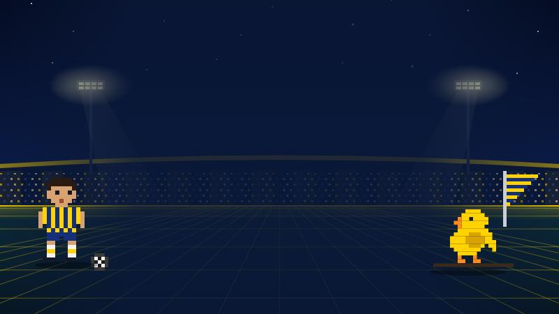

# Fenerbahçe theme for Claude Desktop

**English** · [Türkçe](README.tr.md)

A yellow-and-navy look for Claude Desktop: a night stadium behind the
conversation, floodlights, a crowd in club colors, pitch lines rolling toward
you, a pixel player in a striped kit on the left and a pixel canary with a
pennant on the right. Above and below the prompt it adds usage bars and a
stats line.

> An unofficial fan project. It has no connection to Fenerbahçe Spor Kulübü.
> It ships no club crest and no club artwork; every drawing in it is original.



*The stadium backdrop, still version, with no logo. The usage card and stats
line are drawn by the plugin in the app, above and below the prompt.*

## What you get

- **Colors.** Navy surfaces, canary-yellow accent, light text kept readable
  over the scene. Dark mode only, like a night match.
- **Stadium backdrop.** Animated floodlights and pitch lines, or a still
  version. A darker band runs down the middle so the conversation stays easy
  to read, and the player and canary move inward as the window gets narrower.
- **Usage card above the prompt.** Context, cache, session (5 hours) and week
  (7 days), as segmented bars. On the session and week bars a blue tick marks
  how much of the window's time has passed: if the fill is ahead of the tick,
  you are spending the limit faster than time is passing.
- **Stats line below the prompt.** Model and effort, session time, cost, turn
  and tool counts, plus the app's own hint text.
- **Your own logo.** Put a logo in the top right of the scene (see below).

## Install

In Claude Code:

```
/plugin marketplace add berkanyldrim/fenerbahce-claude
/plugin install fenerbahce@fenerbahce
```

In the desktop app: open **Settings › Plugins**, add the marketplace
`berkanyldrim/fenerbahce-claude`, then install `fenerbahce`. Switch the app to
dark mode.

## Commands

| Command | What it does |
| --- | --- |
| `/fenerbahce live` | Animated stadium (default) |
| `/fenerbahce still` | Still stadium |
| `/fenerbahce off` | Turns off the theme, the usage card and the stats line |
| `/fenerbahce logo <path>` | Shows your own logo file in the top right |
| `/fenerbahce logo remove` | Removes the logo |
| `/fenerbahce status` | Shows the mode and whether a logo was found |

Your choice is kept between sessions. The earlier Turkish words (`canli`,
`sabit`, `kapat`, `sil`) still work.

## Adding a logo

This repository contains no crest. If you want one, bring your own file and
check that you may use it.

```
/fenerbahce logo C:\Users\you\Pictures\logo.svg
```

Or drop a file named `logo.svg` (preferred) or `logo.png` into the plugin's
own folder; the plugin picks it up by itself. The file stays on your
computer.

- **Use an SVG.** The desktop app can drop images (PNG, JPG) embedded in a
  scene, while SVG shapes are always drawn.
- **Size.** Keep the SVG under about 100 KB (100,000 characters). The whole
  scene may not pass 131,072 characters. If your SVG is larger, simplify it or
  remove metadata and comments.
- Scripts and event attributes in an SVG are removed.
- If you replace the file, the backdrop redraws by itself. If it does not,
  run `/fenerbahce status` once.

## Notes

- The backdrop and the card are drawn in the desktop and mobile apps. In a
  terminal the plugin draws only text versions of the usage card and the
  stats line.
- The prompt cache is assumed to live for one hour.
- Session and week figures appear after the first response; until then they
  read "veri yok" (no data).
- Interface text in the card is in Turkish.

## License

MIT. See [LICENSE](LICENSE).
