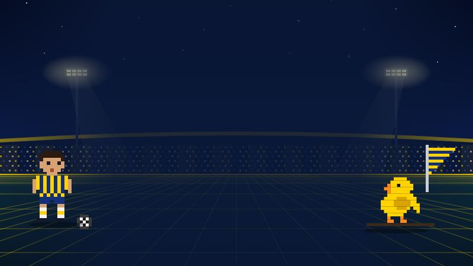

# Claude Desktop için Fenerbahçe teması

[English](README.md) · **Türkçe**

Claude Desktop için sarı-lacivert bir görünüm: konuşmanın arkasında gece
stadyumu, projektörler, kulüp renklerinde tribün, sana doğru akan saha
çizgileri; solda çubuklu formalı piksel bir oyuncu, sağda flamalı piksel bir
kanarya. Mesaj kutusunun üstüne kullanım çubukları, altına bir bilgi satırı
ekler.

> Resmî olmayan bir taraftar çalışmasıdır; Fenerbahçe Spor Kulübü ile bir
> bağı yoktur. İçinde kulüp arması ya da kulübe ait bir çizim yoktur; tüm
> çizimler özgündür.



*Stadyum arka planı, hareketsiz hali, logosuz. Kullanım kartı ve bilgi satırı,
uygulamada mesaj kutusunun üstünde ve altında eklenti tarafından çizilir.*

## Neler var

- **Renkler.** Lacivert zemin, kanarya sarısı vurgu, sahnenin üstünde bile
  rahat okunan açık yazılar. Yalnızca koyu mod; gece maçı havası.
- **Stadyum arka planı.** Hareketli projektörler ve saha çizgileri, ya da
  hareketsiz hali. Ortadan koyu bir bant geçer, böylece yazılar okunaklı
  kalır; pencere daraldıkça oyuncu ve kanarya içeri kayar.
- **Mesaj kutusunun üstünde kullanım kartı.** Bağlam, önbellek, oturum
  (5 saat) ve hafta (7 gün), bölmeli çubuklar olarak. Oturum ve hafta
  çubuklarındaki mavi çizgi sürenin ne kadarının geçtiğini gösterir; dolu
  kısım çizgiyi geçtiyse limiti zamandan hızlı harcıyorsun demektir.
- **Mesaj kutusunun altında bilgi satırı.** Model ve efor, oturum süresi,
  maliyet, tur ve araç sayısı, bir de uygulamanın kendi ipucu yazısı.
- **Kendi logon.** Sahnenin sağ üstüne bir logo koyabilirsin (aşağıya bak).

## Kurulum

Claude Code'da:

```
/plugin marketplace add berkanyldrim/fenerbahce-claude
/plugin install fenerbahce@fenerbahce
```

Desktop uygulamasında: **Ayarlar › Plugins** bölümünde
`berkanyldrim/fenerbahce-claude` pazar yerini ekle, sonra `fenerbahce`
eklentisini kur. Uygulamayı koyu moda al.

## Komutlar

| Komut | Ne yapar |
| --- | --- |
| `/fenerbahce live` | Hareketli stadyum (varsayılan) |
| `/fenerbahce still` | Hareketsiz stadyum |
| `/fenerbahce off` | Temayı, kullanım kartını ve alt satırı kapatır |
| `/fenerbahce logo <path>` | Kendi logo dosyanı sağ üste koyar |
| `/fenerbahce logo remove` | Logoyu kaldırır |
| `/fenerbahce status` | Modu ve logonun bulunup bulunmadığını gösterir |

Seçimin oturumlar arasında saklanır. Eski Türkçe kelimeler (`canli`, `sabit`,
`kapat`, `sil`) da çalışmaya devam eder.

## Logo ekleme

Bu depo hiçbir arma içermez. İstersen kendi dosyanı getir ve kullanma iznin
olduğundan emin ol.

```
/fenerbahce logo C:\Users\sen\Pictures\logo.svg
```

Ya da `logo.svg` (önerilen) ya da `logo.png` adlı dosyayı eklentinin kendi
klasörüne bırak; eklenti onu kendiliğinden kullanır. Dosya yalnızca senin
bilgisayarında kalır.

- **SVG kullan.** Desktop uygulaması sahnenin içine gömülü resimleri (PNG,
  JPG) çizmeyebilir; SVG şekilleri ise her zaman çizilir.
- **Boyut.** SVG'yi yaklaşık 100 KB'ın (100.000 karakter) altında tut. Sahnenin
  tamamı 131.072 karakteri geçemez. SVG'n daha büyükse sadeleştir ya da
  içindeki ek bilgi ve açıklama satırlarını sil.
- SVG içindeki script ve olay öznitelikleri kaldırılır.
- Dosyayı değiştirirsen arka plan kendiliğinden yeniden çizilir. Çizilmezse
  bir kez `/fenerbahce status` yaz.

## Notlar

- Arka plan ve kart Desktop ile mobil uygulamada çizilir. Terminalde eklenti
  yalnızca kullanım kartının ve bilgi satırının yazı halini çizer.
- Önbellek süresinin 1 saat olduğu varsayılır.
- Oturum ve hafta değerleri ilk cevaptan sonra dolar; o zamana kadar "veri
  yok" yazar.
- Kartın arayüz metinleri Türkçedir.

## Lisans

MIT. Bkz. [LICENSE](LICENSE).
